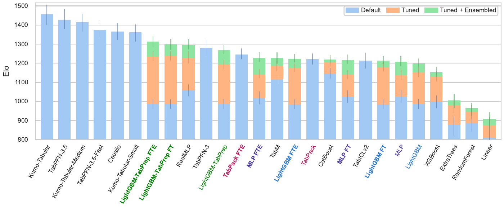
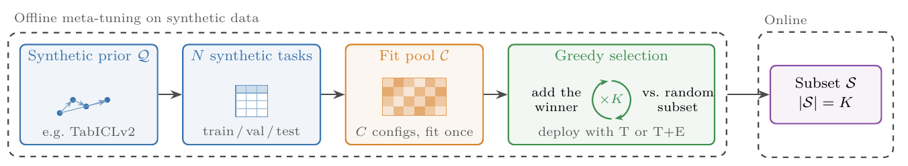
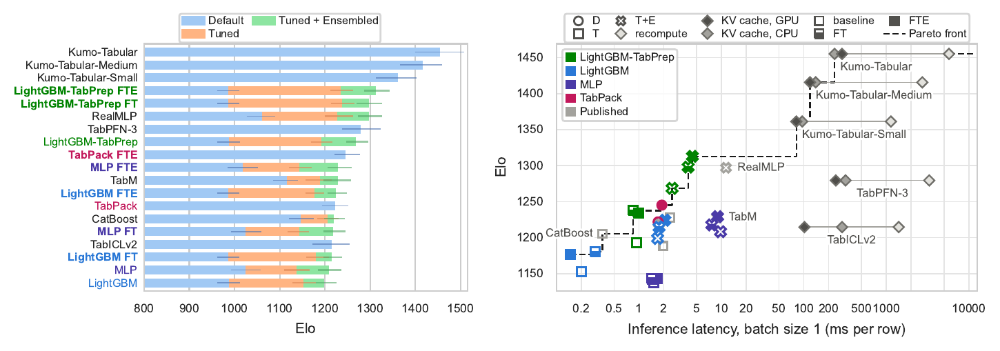
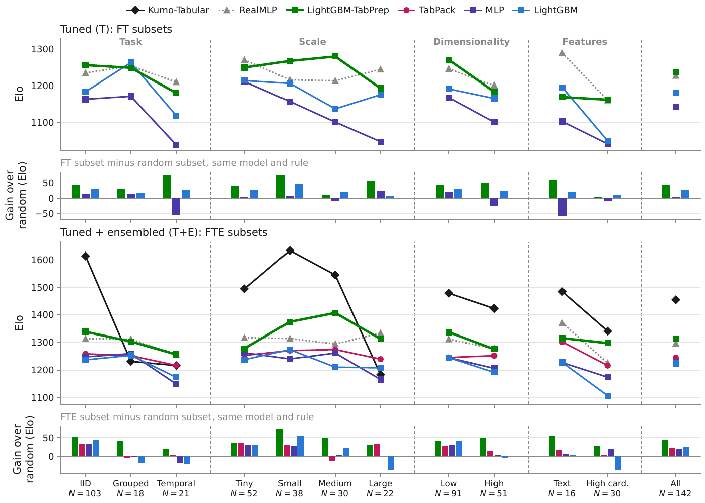
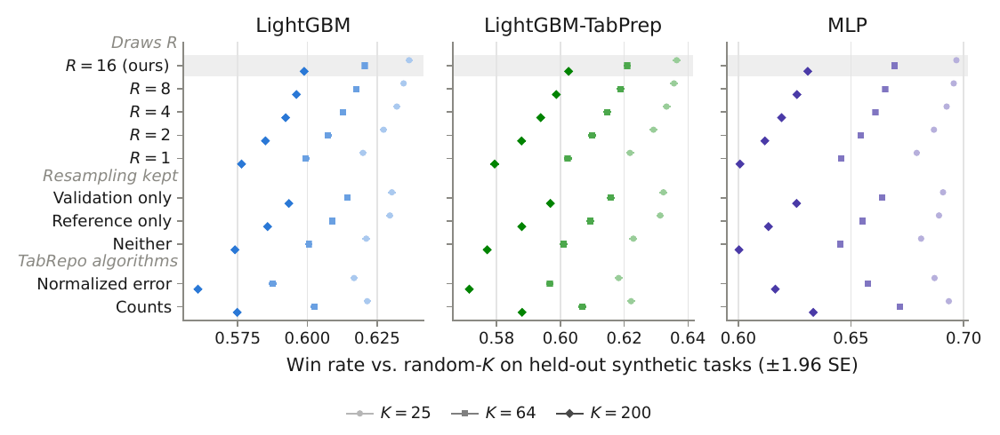
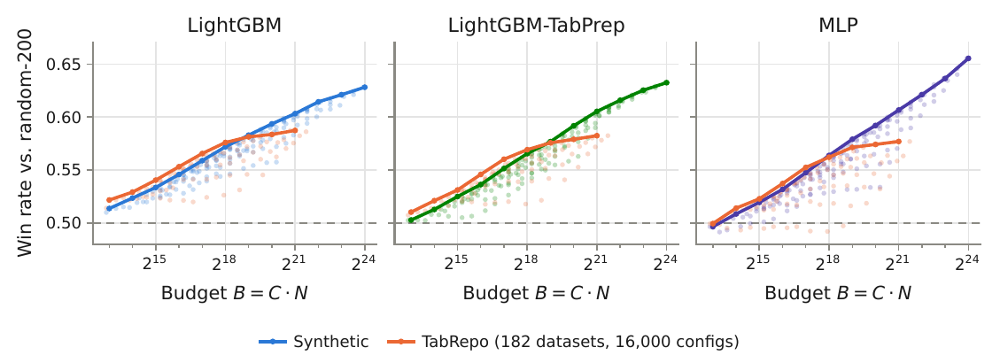
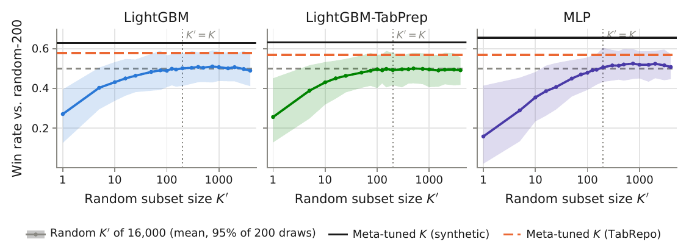
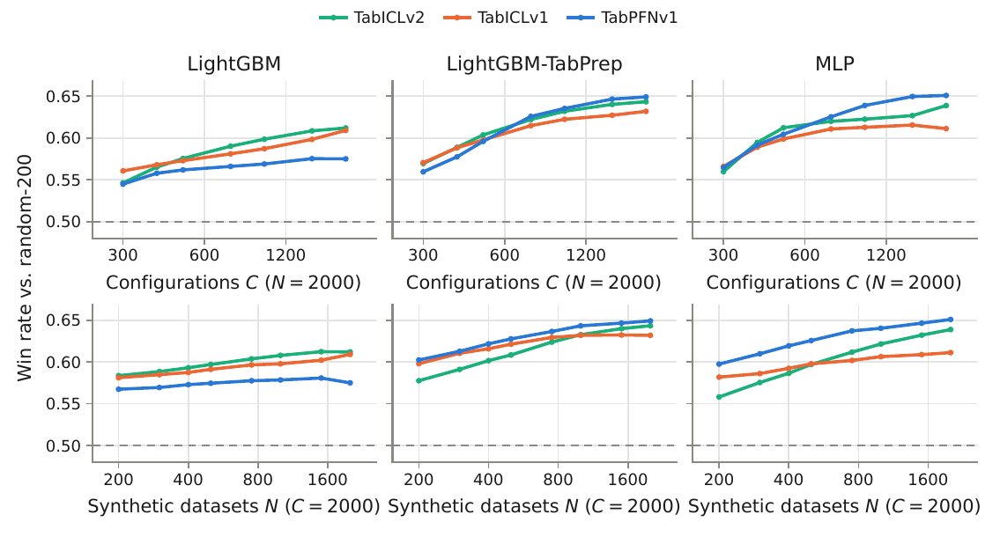
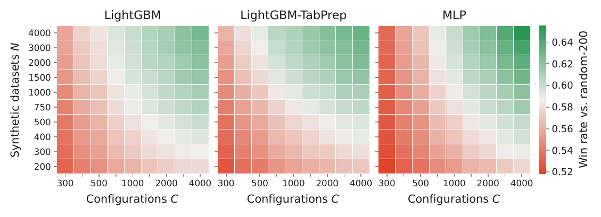
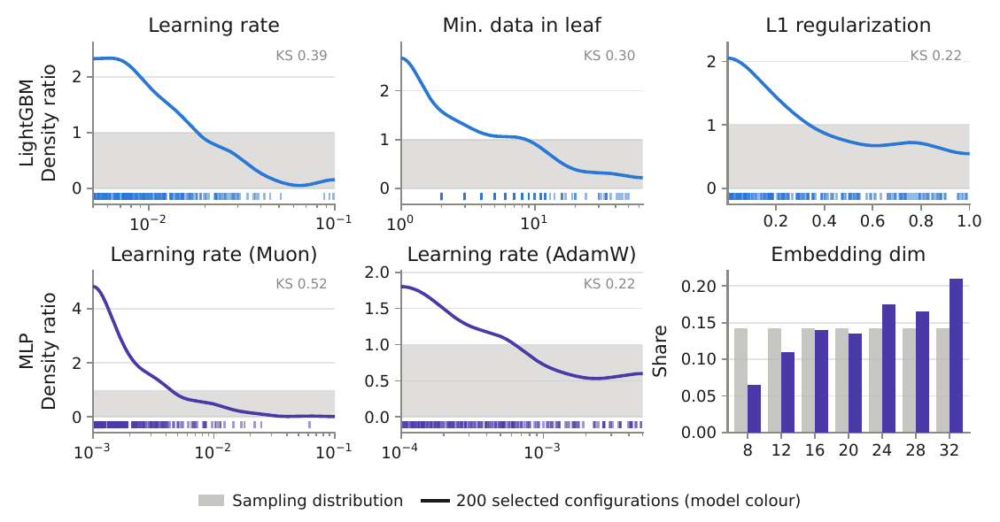

<p align="center"></p>

<h3 align="center">Beyond Foundation Models: PFN Priors Improve Tabular Hyperparameter Optimization</h3>

<p align="center">
Artem Chistyakov*, Renat Sergazinov*, Artem Babenko<br>
<sub>* equal contribution</sub><br>
<a href="https://arxiv.org/abs/2611.05141">Paper</a> ·
<a href="https://yandex-research.github.io/PriorTune/">Website</a> ·
<a href="https://huggingface.co/datasets/mrsergazinov/PriorTune">Dataset</a> ·
<a href="#results-from-the-paper">Results</a> ·
<a href="#citation">Citation</a>
</p>

PriorTune meta-tunes the hyperparameters of conventional tabular models on synthetic
data. It samples N datasets from a tabular prior ([TabICLv2](https://arxiv.org/abs/2602.11139)),
fits a pool of C = 4,000 random configurations of a model on each, and greedily selects
K of them. Each step adds the configuration that wins most often against a random
K-subset when both are deployed by validation and scored on test. We test this approach
with [LightGBM](https://papers.nips.cc/paper/2017/hash/6449f44a102fde848669bdd9eb6b76fa-Abstract.html),
LightGBM with [TabPrep](https://arxiv.org/abs/2606.02384),
[MLP](https://arxiv.org/abs/2203.05556), and [TabPack](https://arxiv.org/abs/2607.05380).

## Contents

- [PriorTune on BeyondArena](#priortune-on-beyondarena)
- [Install](#install)
- [Use PriorTune](#use-priortune)
  - [1. Tune a model on your data](#1-tune-a-model-on-your-data)
  - [2. Design a new selection algorithm](#2-design-a-new-selection-algorithm)
  - [3. Add datasets or configurations](#3-add-datasets-or-configurations)
  - [4. Add a model or a prior](#4-add-a-model-or-a-prior)
- [Results from the paper](#results-from-the-paper)
- [Reproduce the paper](#reproduce-the-paper)
- [Artifacts](#artifacts)
- [Repository layout](#repository-layout)
- [Citation](#citation)
- [License](#license)

## PriorTune on BeyondArena

<p align="center"></p>
<p align="center"><sub>Elo of all 58 methods on the full BeyondArena under default, tuned, and tuned-and-ensembled
deployment. Our models are coloured, with their meta-tuned subsets in bold (FT: selected for T, FTE: for T+E).</sub></p>

> [!TIP]
> **PriorTune (25-200) configurations match or beat random search over 4,000 configurations.** In
> single-best mode (T, the way a model is usually deployed in production), fitting the K
> selected configurations wins head to head against fitting the entire pool of 4,000 and
> keeping the best one. Win rate on TabArena (0.5 is a tie):
>
> | PriorTune (K) vs. random search (4,000) | LightGBM | LightGBM-TabPrep | MLP |
> |---|:---:|:---:|:---:|
> | K = 25 | **0.61** | **0.55** | **0.51** |
> | K = 64 | **0.71** | **0.68** | **0.58** |
> | K = 200 | **0.59** | **0.62** | **0.62** |

## Install

```sh
git clone https://github.com/yandex-research/PriorTune && cd PriorTune
pip install -r requirements.txt
python bin/artifacts.py download configs portfolios scores
```

The last command downloads the selected subsets, the configurations and the score
matrices (about 1 GB) from the [dataset](https://huggingface.co/datasets/mrsergazinov/PriorTune)
into `artifacts/`. Fitting models also needs the training environment:
`pip install -r bin/requirements-experiments.txt` (Linux, with a CUDA GPU for the MLP).

| model id | model | runs on |
|---|---|---|
| `lgbm` | LightGBM | CPU |
| `lgbm-prep` | LightGBM with TabPrep feature engineering | CPU |
| `mlp` | MLP with cosine embeddings | GPU |
| `tabpack` | TabPack, a pack of 64 MLPs | GPU |

Each model has subsets for K = 25, 64 and 200 (TabPack: 64) under two deployment rules.
**T** (tuned) fits the K configurations and keeps the one that is best on validation.
**TE** (tuned + ensembled) builds a greedy ensemble of them on validation.

## Use PriorTune

### 1. Tune a model on your data

Give `tune.py` a training table, a test table and the name of the target column. It
holds out 20% of the training rows for validation, fits the K selected configurations,
deploys them, and writes the test predictions.

```sh
python bin/tune.py --model lgbm-prep --rule TE --k 25 \
    --train train.csv --test test.csv --target price --out predictions.csv
```

```
lgbm-prep, TE, K = 25, task: regression, 331 training rows, 111 test rows
fitted 25/25 (config 3699: done)
deployed 4 of 25 configurations, validation rmse 48.9883
test rmse 55.7009
wrote predictions.csv
```

The task (regression, binary, multiclass) is read from the target. Non-numeric columns
are treated as categorical.

You can also take the configurations and fit them yourself. LightGBM's go straight into
[AutoGluon](https://auto.gluon.ai):

```python
import sys
sys.path.insert(0, 'bin')
import priortune
from autogluon.tabular import TabularPredictor

configs = priortune.subset('lgbm-prep', rule='T', k=25)     # 25 hyperparameter dicts, in selection order
hps = priortune.autogluon('lgbm', rule='TE', k=25)          # {'GBM': [...]} for AutoGluon
predictor = TabularPredictor(label='price').fit(train, tuning_data=val, hyperparameters=hps)
```

### 2. Design a new selection algorithm

The dataset holds the validation and test score of every configuration on every
synthetic dataset. A selection rule is any function that picks K of the 4,000 columns.
`priortune.win_rate` scores your pick the way the paper does: the win rate on TabArena
against random subsets of the same size (0.5 means no better than random).

```python
import sys
sys.path.insert(0, 'bin')
import priortune

synth = priortune.scores('lgbm-prep')        # synth.val, synth.test: 4,000 datasets x 4,000 configs
                                             # (losses, lower is better, NaN where a fit failed)
my_pick = synth.val.mean(axis=0).argsort()[:25]         # your rule here
priortune.win_rate('lgbm-prep', my_pick)                # -> (win rate, 95% interval)

ours = [c['config_id'] for c in priortune.subset('lgbm-prep', 'T', 25)]
priortune.win_rate('lgbm-prep', ours)
```

[`examples/new_selection.py`](examples/new_selection.py) compares two simple rules with
PriorTune. Rules that ensemble or resample need the raw predictions:
`python bin/artifacts.py download labels 'predictions/synthetic-tabicl-v2/lgbm-prep/*'`,
then `artifacts.predictions(...)` and `artifacts.labels(...)` in [`bin/artifacts.py`](bin/artifacts.py).

### 3. Add datasets or configurations

Grow the grid of an existing model in four steps. The published datasets and
configurations stay as they are, and new ones get the next indices.

```sh
# 1. more synthetic datasets: indices 4000 to 7999
PYTHONHASHSEED=0 python bin/priors/tabicl-v2.py --index 4000 --output local/datasets/tabicl-v2

# 2. more configurations: a bank of 8,000 that starts with the published 4,000
python bin/models/lgbm/sample_hp.py --extend 8000 --output local/lgbm-8000.jsonl

# 3. fit (one dataset and one configuration per call)
python bin/models/lgbm-prep/script.py --dataset local/datasets/tabicl-v2/reg-2000 \
    --config-id 4000 --bank local/lgbm-8000.jsonl --output local/fits

# 4. add the fits to the published score matrix and select on it
python bin/models/collect.py --fits local/fits/lgbm-prep --datasets local/datasets/tabicl-v2 \
    --extend artifacts/scores/synthetic-tabicl-v2/lgbm-prep.npz --out local/lgbm-prep.npz
python bin/hillclimb/portfolio.py t --model lgbm-prep --scores local/lgbm-prep.npz --k 25
```

The MLP bank extends the same way (`bin/models/mlp/sample_hp.py --extend`).

### 4. Add a model or a prior

**A new prior** only has to write datasets in the folder layout below. Then fit, collect
and select as in step 3. [`bin/priors/`](bin/priors) has three generators to start from.

```
<name>/
  info.json                     {"task": {"type": "regression", "score": "rmse"}}
  x_num.npy  x_cat.npy  y.npy   features (float32 / int64 codes) and target
  splits/default/train.npy      row indices, also val.npy and test.npy
```

The task types are `regression`, `binclass` and `multiclass`, scored by `rmse`,
`roc-auc` and `cross-entropy`.

**A new model** needs a bank of configurations and a fit script that writes
`<output>/<model>/<dataset>/<config_id>/report.json` with the validation and test score.
[`examples/new_model.py`](examples/new_model.py) does this for a random forest in 87 lines:

```sh
python examples/new_model.py bank --n 1000 --out local/rf.jsonl
python examples/new_model.py fit --bank local/rf.jsonl --dataset local/datasets/tabicl-v2/reg-0000 \
    --config-id 0 --output local/fits
python bin/models/collect.py --fits local/fits/rf --datasets local/datasets/tabicl-v2 --out local/rf.npz
python bin/hillclimb/portfolio.py t --model rf --scores local/rf.npz --k 25
```

## Results from the paper

<table>
<tr><td>

**Overview.** Offline, we sample hyperparameter configurations from a pool, fit them on
N synthetic tasks, and greedily select a subset of K by win rate over random subsets
under the given deployment rule. Online, we fit the K selected configurations once per
task.



</td></tr>
<tr><td>

**Accuracy and inference cost on the full BeyondArena.** Left: Elo under default, tuned
and tuned-and-ensembled deployment. FT and FTE are the subsets meta-tuned under T and
T+E. Right: Elo against the latency of a single-row prediction. Under T, LightGBM-TabPrep
with its FT subset has the highest Elo of all tuned methods. With its FTE subset it
reaches 1313 Elo at 4.4 ms, while the references with a similar Elo are 2.6 to 740 times
slower.



</td></tr>
<tr><td>

**Results by dataset group.** Elo on the full BeyondArena by dataset group, under T (top)
and T+E (bottom). The bars show the gain of each meta-tuned subset over the same model
with a random subset. LightGBM-TabPrep gains in every group, by 21 to 72 Elo under T+E
and by 5 to 76 under T.



</td></tr>
<tr><td>

**Selection rule.** Each of 200 repetitions selects on 3,000 random synthetic tasks and
is scored on the other 1,000. The plain hill-climb, with one validation split and one
reference, trails PriorTune (R = 16) by 0.014 to 0.031. Resampling only the validation
closes 60 to 84% of that gap, and resampling only the references closes 41 to 62%.



</td></tr>
<tr><td>

**Synthetic versus real meta-training data.** Win rate on TabArena at K = 200 for
subsets selected on synthetic data and on TabRepo (182 real datasets), at equal budget
B = C·N. Real data is worth more at small budgets. From 2<sup>19</sup> to
2<sup>20</sup> on, synthetic data overtakes TabRepo, which saturates, and at
2<sup>24</sup> it ends 0.02 to 0.08 above TabRepo's best.



</td></tr>
<tr><td>

**Meta-tuning versus more random search.** Random subsets of growing size K' against
the random-K baseline, at K = 200. The mean curve peaks at 0.50 to 0.53 for K' between
500 and 750 and then falls, as larger random subsets overfit the validation split. The
200 meta-tuned configurations replace a random search over 4,000 configurations that
fits twenty times more models.



</td></tr>
<tr><td>

**Choice of prior.** Three priors (TabICLv2, TabICLv1 and TabPFNv1), each with 2,000
configurations on 2,000 synthetic tasks, at K = 200. No prior wins everywhere.
TabICLv2 leads for LightGBM, the three are within 0.02 of each other with TabPrep, and
TabPFNv1 wins for the MLP at K = 200.



</td></tr>
<tr><td>

**Scaling.** Win rate over the grid of C configurations and N synthetic tasks, at
K = 200. It rises along both axes and neither has saturated at 4,000. A doubling of C
is worth 1.2 to 1.7 doublings of N.



</td></tr>
<tr><td>

**Selected hyperparameters.** The 200 configurations selected under T against the
distribution they are sampled from. For LightGBM, the selection prefers expressive trees
with a small minimum data in a leaf and weak L1 regularization, together with a small
learning rate. For the MLP, it prefers small learning rates and larger embeddings.



</td></tr>
</table>

## Reproduce the paper

Every figure is drawn from the CSV files in [`data/`](data/SOURCES.md):

```sh
python bin/figures/elo_latency.py       # accuracy and inference cost
python bin/figures/main_groups.py       # results by dataset group
python bin/figures/elo_full_field.py    # the full BeyondArena leaderboard
python bin/figures/ablations.py         # selection rule, data, random search, priors, scaling, hyperparameters
```

The experiments behind them run from the dataset:

```sh
python bin/hillclimb/worlds.py --model mlp --out worlds/mlp_R16.npz          # validation bootstraps
python bin/hillclimb/portfolio.py t --model mlp --k 25 --worlds worlds/mlp_R16.npz
python bin/hillclimb/portfolio.py te --model mlp --k 25                       # needs predictions and labels
python bin/hillclimb/grid.py surfaces --model mlp --k 25 --worlds worlds/mlp_R16.npz
python bin/hillclimb/grid.py ladder --model mlp --k 25
```

## Artifacts

The [dataset](https://huggingface.co/datasets/mrsergazinov/PriorTune) holds every fit of the paper.
[`bin/artifacts.py`](bin/artifacts.py) downloads and reads it. Join files on `dataset_index`:
row *i* of every score matrix is `dataset_index` *i* in the other files.

| path | content |
|---|---|
| `configs/{lgbm,mlp}-4000.jsonl` | the configuration banks, line *i* = `config_id` *i*; `lgbm` and `lgbm-prep` share one bank |
| `scores/<corpus>/<model>.npz` | validation and test score matrices, datasets × 4,000 configurations, float64 |
| `predictions/<corpus>/<model>/part-*.parquet` | raw validation and test predictions |
| `labels/<corpus>.parquet` | the labels the predictions are scored against |
| `datasets/tabicl-v2/part-*.parquet` | the 4,000 synthetic datasets with their train / validation / test rows |
| `splits/{tabarena-51,tabrepo-180}.parquet` | split indices of the real corpora; the data itself comes from OpenML and TabArena |
| `portfolios/<model>/{T,TE}_K<k>.json` | the selected subsets |

Corpora are `synthetic-tabicl-v2`, `tabarena-51`, and `tabrepo-180`. Models are `lgbm`, `lgbm-prep`, and `mlp`;
portfolios also cover `tabpack`.

**Predictions.** Each row holds one block of configurations for one dataset and split: `dataset_index`,
`dataset`, `split` (`val` or `test`), `config_id_start`, `config_id_stop`, `shape` (`[configs, rows]` or
`[configs, rows, classes]`), `dtype`, `values` (raw bytes, NaN where a fit failed), and `config_ids`. A block
usually holds 500 configurations and fewer for large datasets. `artifacts.predictions(corpus, model)` puts the
blocks back in `config_id_start` order and returns all 4,000 rows. Values are the positive-class probability
(binary), the class probabilities (multiclass), or the prediction (regression, on the standardized target for
the synthetic corpus).

**Plain LightGBM.** `lgbm` and `lgbm-prep` differ only on the configuration ids divisible by four, where
`lgbm-prep` runs TabPrep. `predictions/<corpus>/lgbm/` therefore stores only these 1,000 reruns, with their ids
in `config_ids`. `artifacts.predictions(corpus, 'lgbm')` rebuilds the full arrays from both folders, so
download both. The `lgbm` score matrices are complete.

**Labels, datasets, splits.** A `labels/` row holds `dataset_index`, `dataset`, `split`, `shape`, `dtype`, and
`values` (int64 class ids or float32 targets). A `datasets/tabicl-v2/` row holds `x_num`, `x_cat` (empty without
categorical features), and `y` as `.npy` bytes, the `train`, `val`, and `test` row indices, and an `info` JSON
with the generator seeds and shapes; read them with `artifacts.synthetic_datasets()`. A `splits/` row holds
`dataset`, `source_name`, `split`, `part`, `indices`, and an `info` JSON with the task, the metric, and the
OpenML ids; read them with `artifacts.splits(corpus)`.

## Repository layout

```
bin/
  priortune.py     load subsets and score matrices, score a subset
  tune.py          fit a subset on your data
  artifacts.py     download and read the dataset
  hillclimb/       the selection algorithm and the scaling experiments
  priors/          synthetic dataset generators (TabICLv2, TabICLv1, TabPFNv1)
  models/          fit one configuration on one dataset, collect fits into a score matrix
  figures/         the paper's figures
examples/          a new selection rule and a new model
data/              inputs of the paper's figures
website/           the project page (yandex-research.github.io/PriorTune)
```

## Citation

```bibtex
@article{chistyakov2026priortune,
  title   = {Beyond Foundation Models: {PFN} Priors Improve Tabular Hyperparameter Optimization},
  author  = {Chistyakov, Artem and Sergazinov, Renat and Babenko, Artem},
  journal = {arXiv preprint arXiv:2611.05141},
  year    = {2026}
}
```

## License

Apache-2.0 ([LICENSE](LICENSE)). Vendored third-party code keeps its own license.
